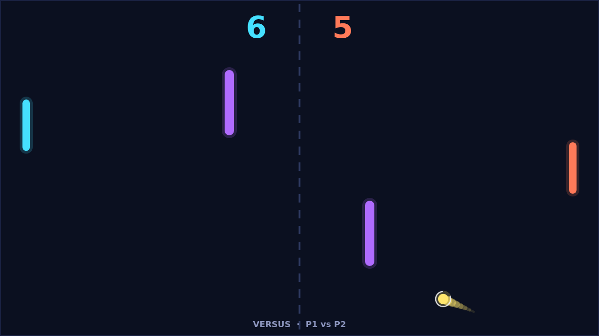

# Carom

Carom is a paddle duel played from above on a dark field. Two paddles face each
other across a dashed net, a ball waits at the center, and two bars stand
mid-field, one high on the left and one low on the right. Serve, return, and
try to put the ball past the paddle on the far side. First to eleven wins, and
you have to win by two, so a 10–10 match keeps going until someone pulls ahead.

A match opens with the ball held at the center for a one-second count, then it
leaves toward the player who was last scored on, at a shallow angle up or down.
The opening rallies are slow and polite: the ball leaves a paddle at a speed set
by where it struck, straight across from the middle, sharply angled from the
tips. Every paddle hit adds a little speed, up to a cap, so a long rally gets
quicker and quicker until someone misses.

Spin is what makes Carom Carom. Move your paddle while you strike and the ball
curves after it leaves: a downward swipe bends the flight clockwise, an upward
swipe bends it the other way, and a trail behind the ball shows the arc. The
curve is strongest right off the paddle and fades over the next second, which
means a well-timed swipe near the net bends more than one from deep. Hit still
and the ball flies true; hit on the move and it drifts, which is exactly what a
defender does not want to see.

The two obstacles turn an open field into a bank-shot puzzle. The ball ricochets
off them with its spin intact, so a curving shot can glance off a bar and come
in from an angle the other paddle never expected. Learn where the bars are and
you start aiming for them on purpose; forget where they are and your clean
winner comes straight back at you.

Play Solo against a machine opponent that reads the ball and chases it down, or
Versus with a friend on the same keyboard. Pause any time, mute the blips if you
must, and when the match is over, play again from the same screen.
